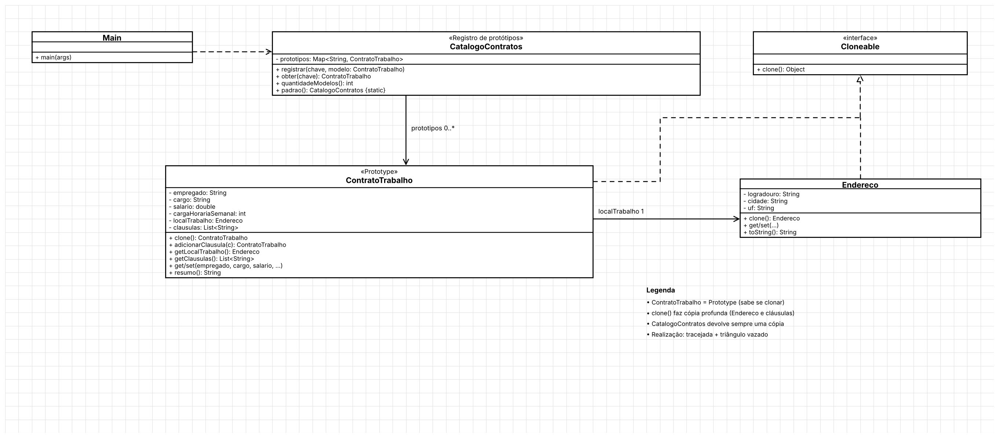

# Padrão Prototype — Modelos de contrato de trabalho

Exemplo do padrão criacional **Prototype**: o RH mantém modelos de contrato aprovados e cria novos contratos **clonando** o modelo. O clone é profundo (endereço e lista de cláusulas são copiados), então personalizar uma cópia nunca altera o modelo do catálogo.

## Diagrama UML

## Participantes do padrão

| Papel | Classe |
|---|---|
| Prototype | `ContratoTrabalho` (`clone()`) |
| Objeto aninhado clonável | `Endereco` |
| Registro de protótipos | `CatalogoContratos` |
| Cliente | `Main` |

## Casos de teste (JUnit 5)

- `ContratoTrabalhoTest` (7 testes): clone com mesmos dados, cópia profunda do endereço e das cláusulas, independência dos campos simples, resumo, lista somente leitura.
- `CatalogoContratosTest` (6 testes): modelos do catálogo, cópia nova a cada `obter`, personalização sem afetar o modelo, isolamento no registro, modelo inexistente.

## Como executar

- **IntelliJ**: `File > Open` e selecione a pasta do projeto (o `pom.xml` é importado automaticamente; JDK 11).
  - Testes: botão direito em `src/test/java` > *Run 'All Tests'*.
  - Demonstração: execute a classe `padroescriacionais.prototype.Main`.
- **Maven**: `mvn test`

O diagrama pode ser regerado com `python docs/gerar_uml.py` (requer matplotlib).
